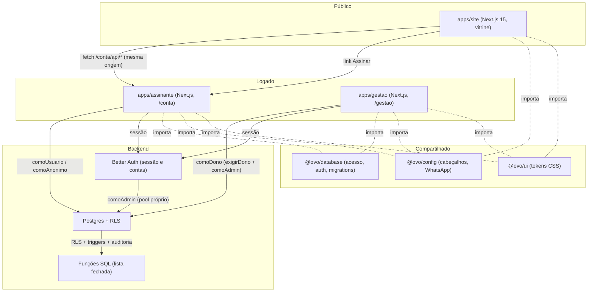

# Codebase Map: Ovo di Onça

> Auto-generated by Cartographer. Last mapped: 2026-11-12T13:16:55Z
> Atualização completa. A versão anterior era de 23/10/2026; desde então houve 3 commits principais (`7d4f310`, `4de7eaf`, `e3106c1`) e 164 arquivos alterados.

## System Overview

**Ovo di Onça** é um sistema de assinatura de ovos caipiras: pedido → entrega (semanal, quinzenal ou mensal, às quartas) → cobrança manual por PIX. O núcleo é um Postgres com RLS, acessado por dois apps Next.js (assinante e gestão) e uma landing page Next.js (site). Segurança em camadas: middleware (só cookie), sessão via Better Auth, papel lido do banco, RLS e funções SQL com lista fechada de campos.

Os três apps dividem um domínio na Vercel (`vercel.json`): `/conta/*` vai ao assinante, `/gestao/*` ao gestão e o resto ao site.



---

## Estado atual (12/11/2026)

### O que mudou desde 23/10
- **Site:** o `apps/site` é **Next.js 15 (App Router) com React 19 e Tailwind 4**, não uma SPA Vite como dizia o mapa anterior. Uma única rota `/` com seções por âncora. A marca e o WhatsApp ficam no pacote `@ovo/config`.
- **Roteamento de produção:** `vercel.json` com três `services` (site, assinante, gestao) e rewrites ordenados. Em dev, o `next.config.ts` do site faz rewrite de `/conta` e `/gestao` para as portas 3001 e 3000.
- **Gestão:** `/configuracoes` existe (o mapa de 23/10 dizia que não). Visual novo em andamento (Design System, componentes locais).
- **Banco:** 24 migrations (`1758758401000` a `1758758423000`). Novidades: calendário fixo de quartas e regra de corte (421), snapshot do cálculo da fatura (418), tabela de pausas (419), selo do plano (420), área de entrega recalculada no banco (417), estabilidade da rotina (416).
- **Commits recentes:** `e3106c1` (correções da vitrine, visual do gestão e limpeza), `4de7eaf` (três apps no mesmo domínio via Vercel Services), `7d4f310` (slogan no Hero).

### Divergências entre documentação e código
Itens marcados como feitos na documentação que o código não confirma:
1. **CSP em report-only** nos três apps. `docs/SEGURANCA.md` diz que seria enforced no PR-5.
2. **Rate limit do Better Auth em memória.** Por instância; em serverless o limite real é mais frouxo.
3. **Rate limit em banco (migration 423) e `rate-limit-server-action.ts` não são usados.** O helper não compila e não está no `exports`. Nenhuma Server Action o aplica. `RATE-LIMIT-DB-CONFIG.md` e `SERVER-ACTIONS-RATE-LIMIT.md` são propostas, não estado atual.
4. **Migration 422** duplica RLS que já existia desde as fases 1 a 4. Suas policies de update e delete são inertes. **O Down é perigoso:** desliga a RLS de `clientes`, `assinaturas`, `entregas` e `faturas`, e concede `insert` a `app_usuario`.
5. **Testes fora do `package.json`:** `tests/teste-fase10-rate-limit.sql` e `tests/teste-fase10-rls-pii.sql` não têm script (rodar com `node scripts/rodar-sql.mjs tests/<arquivo>`).
6. **CI:** o job `banco` pula com aviso se `DATABASE_TEST_URL` não existir; o CI pode ficar verde sem nenhum teste de banco. O workflow está no `.github/workflows/ci.yml`, mas o mapa anterior dizia que ainda não estava commitado. Não verifiquei se mudou.
7. **Bug de CSS:** `componentes.css` usa `var(--red-700)`, que não existe em `ds.css`.
8. **Regras de cobrança D1 a D15:** `DECISOES.md` diz "ainda não implementadas". Só D9 (corte) e D10 (calendário) estão no código. O valor da fatura usa a regra `mensalidade-fixa-v1`.
9. **Fontes:** o Design System (Outfit, Archivo, IBM Plex Mono) vale só para o gestão. Site e assinante usam Aclonica e Poppins, que o mapa reporta como não carregadas de fato. Confirmar.
10. **`docs/superpowers/*` de 07/10** (spec e plano de biblioteca em `packages/ui`) estão superados pelo plano visual de 19/10. Histórico.

### Contradições entre documentos
- **Número de migrations:** CLAUDE.md diz 24 e 22 no mesmo arquivo; DIAGNOSTICO (30/09) diz 14; PROGRESSO (25/09) diz 12. Valor real: **24**.
- **`README.md`:** o banner diz "Fase 0 concluída, ainda não existe tela", mas o projeto está nas fases 9 e 10. A própria tabela diz 25 verificações e um título diz 15.
- **`DECISOES.md`:** cabeçalho diz "Última atualização: 28/09", mas tem seções de 30/09, 19/10 e 22/10. Ainda cita `PROGRESSO.md` como fonte de pendências.
- **`FUNCIONALIDADES-SITE.md`:** cita "22 bairros de BH", `CheckoutModal` e selo "Mais escolhido". Nada disso existe mais. Histórico.
- **`PROGRESSO.md`:** obsoleto. Não usar como estado atual.
- **Vínculo conta↔cliente:** `PROGRESSO` diz automático por e-mail. Os outros docs e o código dizem só com e-mail verificado. Sem serviço de e-mail, o dono vincula manualmente.
- **Frete:** `DECISOES` registra que o frete do mensal foi para R$ 1,00 e voltou a R$ 0,00 no mesmo dia. A fatura não soma frete.

---

## Directory Structure

```
Ovo di Onça/
├── .github/workflows/ci.yml       # CI: instalar, tipos, lint, testes, segurança, build (matriz), banco
├── .superpowers/                  # metadados de skills (não é código)
├── .gitattributes, .gitignore, .npmrc
├── package.json                   # raiz: nome "ovodionca", pnpm 9.12.3, Node >= 20.11
├── pnpm-workspace.yaml            # apps/* e packages/*
├── tsconfig.base.json             # ES2022, Bundler, estrito (noUncheckedIndexedAccess etc.)
├── vercel.json                    # 3 services + rewrites (/conta, /gestao, resto para site)
├── .env / .env.example            # segredos (raiz; .env não rastreado)
├── subir-teste.ps1                # sobe gestão e assinante no branch de teste do Neon
├── scripts/verificar-segredos.sh  # 8 checagens de segurança (roda no pre-commit e no CI)
├── README.md, CLAUDE.md, DECISOES.md, PROGRESSO.md, FUNCIONALIDADES-SITE.md
├── docs/                          # documentação de planejamento e segurança (ver seção Documentação)
│
├── apps/
│   ├── site/                      # vitrine Next.js 15 (porta 3002). Só lê; não coleta dados.
│   │   └── src/app/               # page.tsx → SiteApp; layout.tsx (fontes, metadados); robots.ts; sitemap.ts
│   │       src/components/        # Navbar, Hero, PlansSection, ComparisonTable, NeighborhoodSection, FaqSection, Footer
│   │       src/hooks/             # usePlanos, useBairros
│   │       src/lib/               # api.ts (fetch em /conta/api/*), formatar.ts
│   │
│   ├── assinante/                 # área do cliente + API pública (porta 3001, basePath /conta)
│   │   └── src/app/               # page.tsx (minha assinatura), dados/, entrar/, cadastro/, assinar/,
│   │                              # acoes.ts, _componentes/, api/auth, api/plans, api/neighborhoods, api/area
│   │       src/lib/               # assinante.ts (exigirSessao, comoAssinante), erros.ts, validacao.ts,
│   │                              # seguranca.ts (caminhoInterno), planos.ts, cache-publico.ts, formatar.ts, tipos.ts
│   │       src/middleware.ts      # só confere cookie; libera rotas públicas
│   │       tests/                 # banco-teste, cache-publico, seguranca, whatsapp (node --experimental-strip-types --test)
│   │
│   └── gestao/                    # painel do dono Next.js 15 (porta 3000, basePath /gestao)
│       └── src/app/               # page.tsx (painel), clientes/, assinaturas/, entregas/, faturas/,
│                                  # area-de-entrega/, historico/, configuracoes/, entrar/, acoes-painel.ts,
│                                  # _componentes/ (DS local), api/auth, api/rotina
│       src/lib/                   # dono.ts (comoDono), erros.ts, validacao.ts, formatar.ts, rotulos.ts, diff.ts, tipos.ts
│
├── packages/
│   ├── database/                  # @ovo/database: acesso ao Postgres, Better Auth, migrations, testes SQL
│   │   ├── src/                   # acesso.ts, env.ts, types.ts, email.ts, rotina.ts, middleware.ts, rate-limit (inativo)
│   │   │   └── auth/              # better-auth.ts (servidor), cliente.ts (navegador), papel.ts
│   │   ├── migrations/            # 24 arquivos, 1758758400000 a 1758758423000 (node-pg-migrate)
│   │   ├── tests/                 # *.sql: lei1-estrutura, autorizacao, fase1 a fase10, etapa1, etapa2
│   │   └── scripts/               # rodar-sql.mjs, banco-teste.mjs, migrar-teste.mjs, criar-papel-servidor.mjs,
│   │                              # conferir-bloco0.mjs, previa-teste.mjs, limpar-dados-teste.sql
│   │
│   ├── ui/                        # @ovo/ui: só CSS. tokens.css (todos), ds.css (só o gestão)
│   └── config/                    # @ovo/config: headers.mjs (cabeçalhos e CSP) e whatsapp.mjs (número único)
│
└── (fora do escopo deste mapa)
    ├── Ovo di Onça Design System/ # 85 MB, referência, não importada pelos apps (no .gitignore)
    ├── Interface Stitch/          # exportação de design
    ├── folhetos/                  # material impresso (PNG e PDF)
    ├── graphify-out/              # saída do grafo de conhecimento
    ├── _a-apagar/                 # triagem de descartes (no .gitignore)
    └── .claude/                   # skills e configuração do Claude Code
```

---

## Module Guide

### `apps/site`: vitrine

**Papel:** marketing e conversão. Não coleta dado pessoal. O botão "Escolher <plano>" leva a `${NEXT_PUBLIC_URL_ASSINANTE}/conta/assinar?plano=<frequencia>`, onde ficam conta, endereço e assinatura.

**Entrada:** `src/app/page.tsx` → `SiteApp` (client). Ordem: Navbar → Hero (`#inicio`) → PlansSection (`#planos`) → ComparisonTable (`#comparativo`) → NeighborhoodSection (`#entrega`) → FaqSection (`#faq`) → Footer.

**Dados:**
- Planos e preços vêm de `GET /conta/api/plans` (`planos_publicos()`). Frescor, frete e desconto vêm do plano. Destaque vem de `planos.selo`, não do nome.
- Bairros e área vêm de `/conta/api/neighborhoods` e `/conta/api/area?cep=`.
- `lib/api.ts` usa caminho relativo (`/conta`), então não há CORS.

**Conteúdo fixo (hard-coded):** textos do Hero, `COMPARISON_ROWS`, `FAQ_ITEMS` ("7 dias", "frete grátis", "10% no 1º mês" escritos à mão). Mudar uma regra comercial exige editar os cards (banco) e os textos fixos (código). `resumoPlanos` em `formatar.ts` existe para derivar esses textos, mas nenhum componente o usa. `mascararTelefone`, `telefoneValido` e `precoComDesconto` também parecem sem uso.

**Gotchas:**
- Em dev, o site precisa do assinante na porta 3001. Sem ele, planos, bairros e área falham com "Não foi possível carregar".
- `robots.ts` e `sitemap.ts` dependem de `NEXT_PUBLIC_URL_SITE`. Sem ela, o sitemap fica vazio.
- Telefone do rodapé e FAQ divergem do link WhatsApp (a confirmar). O número vem de `@ovo/config/whatsapp`, e o teste `whatsapp.test.ts` impede que ele apareça fora desse pacote.

### `apps/assinante`: área do cliente e API

**Papel:** portal logado (`/conta`), fluxo de assinatura, API pública de leitura.

**Config:** `basePath` `/conta`, cookie com prefixo `ovo-conta` (separado do gestão). Carrega o `.env` da raiz. Headers de segurança de `@ovo/config`.

**Middleware:** só verifica se existe o cookie de sessão. Libera `/api/auth*`, `/api/plans*`, `/api/neighborhoods*`, `/api/area*`, `/entrar`, `/cadastro`, `/assinar`, `/recuperar-senha` e `/redefinir-senha`. As duas últimas estão na lista mas **não têm páginas**. Usa `startsWith`, então `/assinarX` também passa.

| Rota | Auth | O que faz |
|---|---|---|
| `/` (`page.tsx`) | `exigirSessao` + `comoUsuario` (RLS) | cliente, assinatura, entregas, faturas, pedidos pendentes; `?nova=1` mostra confirmação |
| `/dados` | `exigirSessao` | edita nome, telefone e endereço (`atualizar_meus_dados`) |
| `/entrar`, `/cadastro` | pública | Better Auth via `authClient`; `proximo` sanitizado com `caminhoInterno` |
| `/assinar?plano=` | pública + sessão opcional | máquina de estados: vitrine → sem sessão (criar conta/entrar) → papel errado bloqueia → assinatura vigente redireciona → endereço (`criar_meu_cadastro`) → fora da área → confirmar (`assinar_plano`) |
| `/api/auth/[...all]` | Better Auth | cadastro, login, logout |
| `/api/plans` | `comoAnonimo` | `planos_publicos()`; cache de 30 s; camelCase para o site |
| `/api/neighborhoods` | `comoAnonimo` | `distinct bairro` das faixas ativas; cache de 30 s |
| `/api/area?cep=` | `comoAnonimo` | `cep_dentro_area_entrega`; `{atendido}`; sem cache |

**Server Actions:**
- `app/acoes.ts`: `atualizarMeusDados` (lista fechada), `solicitarAlteracao` (pausa ou cancelamento; **só pede**, quem executa é o dono).
- `app/assinar/acoes.ts`: `criarMeuCadastro` (`criar_meu_cadastro`) e `confirmarAssinatura` (busca o plano por `frequencia` e chama `assinar_plano`). Nenhuma action recebe id de cliente, e-mail, status, preço ou data.

**Lib:**
- `assinante.ts` (server-only): `exigirSessao()` (página), `comoAssinante(fn)` (action, `comoUsuario` sob RLS), `buscarCliente`.
- `erros.ts`: `ErroNegocio` (código `OV001`, mensagem exibível); `23505` vira "já existe"; outros erros viram "Erro inesperado" com log. `rodar()` relança `redirect` do Next.
- `seguranca.ts`: `caminhoInterno` (aceita só caminho com uma barra, até 300 caracteres; recusa `//`, barra invertida, URL absoluta, `javascript:`).
- `cache-publico.ts`: cache em memória por instância, só para dado público, com TTL de 30 s.

**Gotchas:**
- O app nunca usa a conexão admin.
- `redirect()` dentro de `rodar()` precisa de `unstable_rethrow` (já tratado em `erros.ts`).
- Links de `next/link` ganham o `/conta` sozinhos. `fetch` manual precisa de `NEXT_PUBLIC_BASE_PATH`.
- `/api/area` bate no banco a cada chamada e não tem rate limit.

### `apps/gestao`: painel do dono

**Papel:** clientes, assinaturas, entregas, faturas, área de entrega, configurações, histórico.

**Config:** `basePath` `/gestao`, cookie `ovo-gestao`, `robots: noindex`. Fontes Outfit, Archivo e IBM Plex Mono via `next/font`. CSS: `tokens.css`, `ds.css`, `globals.css`, `componentes.css`.

**Guarda:** toda página e action começa com `exigirDono()` (papel lido do banco). Leitura: `comoUsuario` (RLS). Escrita: **só** `comoDono(fn)`, que chama `exigirDono()` e depois `comoAdmin(..., {usuarioId})` para a auditoria. Exceção: `/` checa `usuarioAtual()` e `papel` à mão, e as páginas de cliente e assinatura chamam `comoAdmin` (sempre depois de `exigirDono`).

| Rota | Conteúdo |
|---|---|
| `/` | painel: contadores, entregas de hoje, pendências, botão "Rodar rotina agora" |
| `/entrar` | login (sem cadastro público; `/api/auth` devolve 404 para `/sign-up`) |
| `/clientes`, `/clientes/novo`, `/clientes/[id]` | busca (limite 200); ficha com endereço, plano, conta de login (`vincularConta`, `desvincularConta`), assinatura (`criarAssinatura`) |
| `/assinaturas`, `/assinaturas/[id]` | lista e pedidos pendentes; ficha com pausa, cancelamento, reativação, forma de cobrança, cobrança, fatura avulsa, troca de plano, entregas, reposições (maior página, ~547 linhas) |
| `/entregas` | visão do dia ou atrasadas; marcar entregue, não entregue (com reagendamento), cancelada; agendar; horário; observação; registrar defeito |
| `/faturas` | devendo, pagas ou todas; registrar pagamento; cancelar |
| `/area-de-entrega` | faixas de CEP (criar, editar, ativar, remover); recalcula clientes |
| `/historico` | auditoria com filtros; diff antes e depois (`calcularMudancas`) |
| `/configuracoes` | preços, corte e regras de indicação (`config_negocio`); planos (bloqueia desativar plano com assinatura vigente) |
| `/api/rotina` (POST) | rotina diária; autorização por `Bearer CRON_SECRET` (não passa por `comoDono`) |

**Server Actions:** em `clientes/acoes.ts`, `assinaturas/acoes.ts`, `entregas/acoes.ts`, `faturas/acoes.ts`, `area-de-entrega/acoes.ts`, `configuracoes/acoes.ts` e `acoes-painel.ts` (`rodarRotinaDiaria`). Todas seguem `(estado, FormData) => Promise<Estado>`, validam, escrevem via `comoDono`, chamam `revalidatePath` na mão.

**Componentes:** em `_componentes/`: `FormAcao` (padrão de formulário), `Dialogo` (sobre `<dialog>`), `Aviso`, `Botao`, `Campo`, `Tabela`, `Selo`, `CartaoResumo`, `Vazio`, `Icone`, `ConfirmarAcao`, `Pagina` (moldura provisória). Plus `clientes/campos-cliente.tsx`, `assinaturas/solicitacoes.tsx`, `entregas/acoes-entrega.tsx`, `faturas/acoes-fatura.tsx`.

**Gotchas:**
- **Migração do Design System pela metade.** Nenhuma página importa `Botao`, `Campo`, `Tabela`, `Selo`, `Vazio`, `CartaoResumo`, `Dialogo` ou `ConfirmarAcao` diretamente. As páginas usam `<table>` e `<input>` crus e classes antigas (`msg-erro`). `/entrar` ainda usa tokens antigos.
- **Ações destrutivas sem confirmação:** cancelar assinatura, remover faixa, desvincular conta e cancelar fatura não usam `confirmar`.
- **Revalidação manual:** tela nova que mostre dado já existente precisa entrar nos `revalidatePath` de cada action.
- **Recalcular CEP em lote:** qualquer mudança em faixa faz `update clientes set cep = cep` em todos os clientes com CEP. O custo cresce com a base. (Mitigado: o trigger `faixas_reavaliam_clientes_tg` da migration 417 recalcula no banco.)
- **Cartão não tem integração:** `definirFormaCobranca('cartao')` só marca a forma. Cada pagamento é registrado à mão.
- **`marcar_faturas_atrasadas()`** roda como parte da visão de faturas.
- **Listas sem paginação:** limites fixos de 200, 300 e 500.

### `packages/database`: acesso, auth, migrations

**Papel:** ponte entre apps e Postgres. Abre transações com papel e declara o usuário; o banco aplica RLS.

**Duas conexões:**

| Variável | Papel no Postgres | Pool | Usada por |
|---|---|---|---|
| `DATABASE_URL` | `app_servidor` (login; só vira `app_anon` ou `app_usuario`; `inherit false`) | max 10 | `comoAnonimo`, `comoUsuario` |
| `DATABASE_ADMIN_URL` | dona das tabelas (ignora RLS) | max 4 | `comoAdmin`, Better Auth, scripts, migrations |

`app_servidor` não consegue virar dona das tabelas. Essa fronteira separa "o app" de "o administrador". O papel `app_servidor` é criado por `scripts/criar-papel-servidor.mjs`, não por migration (a senha não pode ir ao Git).

**Como a transação é montada:** `emTransacao` faz uma ida ao banco com `begin; select set_config('role', ..., true), set_config('app.usuario_id', ..., true)`. Valores vão por `escapeLiteral`. `set_config(..., true)` morre com a transação, então não vaza contexto entre requisições mesmo com pool. Lista fechada de papéis conferida em runtime.

**API de `acesso.ts`:**
- `comoAnonimo(fn)`: papel `app_anon`.
- `comoUsuario(id, fn)`: papel `app_usuario`; lança erro se `id` vazio.
- `comoAdmin(fn, {usuarioId?})`: sem papel (dona). Lança erro se rodar no navegador. `usuarioId` só preenche `app.usuario_id` para a auditoria.
- `encerrarConexoes()`, `OCIOSIDADE_CONEXAO_MS` (5 min), `ouvirErrosDoPool` (evita queda do Node quando o Neon derruba conexão ociosa).

**Exports (`package.json`):**

| Import | Conteúdo |
|---|---|
| `@ovo/database` | `exigirEnv`, `envOpcional`, acesso, tipos |
| `/acesso` | acesso e `ouvirErrosDoPool` |
| `/auth` | `auth`, `confirmacaoDeEmailAtiva`, `loginComGoogleDisponivel`, `Sessao` |
| `/auth-cliente` | `authClient` (único que pode ir ao navegador) |
| `/papel` | `usuarioAtual`, `exigirPapel`, `exigirDono` |
| `/types` | tipos de domínio |
| `/middleware` | `temCookieDeSessao`, `redirecionarParaLogin` |
| `/rotina` | `rodarRotinaComSegredo`, `ResultadoRotina` |

`email.ts` e `rate-limit-server-action.ts` não são exportados.

**Better Auth (`auth/better-auth.ts`):**
- Login por e-mail e senha (mínimo 12 caracteres) e Google (opcional; só monta se as duas variáveis existirem).
- `trustedProviders: ['google']`: só o Google confirma e-mail, então só ele vincula conta por e-mail.
- Confirmação de e-mail só se Resend estiver configurado. O envio não usa `await`, para o tempo de resposta não revelar se o e-mail existe.
- Rate limit em memória: geral 100/60 s; login 5/60 s; cadastro 5/hora.
- Sessão de 7 dias, renovada a cada 24 h. Cookie `httpOnly`, `sameSite: lax`, `path = APP_BASE_PATH`.
- `trustedOrigins` precisa incluir as origens dos apps; senão o navegador recebe "Invalid origin".

**Papel (`auth/papel.ts`):** `usuarioAtual()` lê a sessão e o papel de `perfis` via `comoUsuario` (RLS). O papel nunca vem do corpo da requisição. `exigirPapel(...)` devolve `{ok, usuario}` ou `{ok:false, erro}` com mensagem genérica.

**Rotina (`rotina.ts`):** exige `Bearer <CRON_SECRET>` (mínimo 32 caracteres; `timingSafeEqual`). Sem `CRON_SECRET`, a rota HTTP fica desligada. Chama `processar_rotina_diaria()` via `comoAdmin`.

**Email (`email.ts`):** adaptador HTTP do Resend, sem dependência nova. Lança erro se não configurado (nunca finge enviar). Timeout de 10 s. Log só com o status HTTP.

**Gotchas:**
- `comoAdmin` ignora RLS. Chamar só depois de `exigirDono()` ou `exigirPapel()` no mesmo arquivo (Lei 7). Nenhuma consulta de negócio deve usar `comoAdmin`.
- `auth/rate-limit-server-action.ts` está **quebrado e inativo**: importa `emTransacao` de `./acesso` (não exportada; caminho errado), usa `db.query(...).rows` (não existe no `Executor`), e `usuario.id` onde o tipo tem `usuarioId`. Excluído do `tsconfig.json`. Tratar como rascunho.
- Testes SQL só rodam no banco de teste (`DATABASE_TEST_URL`), sem fallback para o principal.

### `packages/database/migrations`: 24 arquivos

Todas com `-- Up Migration` e `-- Down Migration` (node-pg-migrate). Erro de negócio usa `SQLSTATE 'OV001'`. Dinheiro sempre em centavos inteiros. "Hoje" é `hoje_sp()` (America/Sao_Paulo).

| # | Arquivo (prefixo `1758758`) | Conteúdo | Gotcha |
|---|---|---|---|
| 400 | `better-auth-tabelas` | `"user"`, `"session"`, `"account"`, `"verification"` (camelCase, ditado pela lib) | não renomear colunas; RLS sem policy e sem grant |
| 401 | `fase0-papeis-perfis-rls` | roles `app_anon`/`app_usuario`, schema `app`, enum `papel_usuario` (`dono`, `assinante`), `perfis`, `meu_papel()`, `sou_dono()`, `definir_papel()`, triggers | a guarda `current_role` em `perfis_protege_colunas` (SECURITY DEFINER) provavelmente nunca dispara; restam grant de coluna e `with check` |
| 402 | `fase1-configuracao-e-planos` | `config_negocio` (linha única), `planos` (seed semanal 7 d, quinzenal 15 d, mensal 30 d), `faixas_cep_atendidas`, `cep_dentro_area_entrega()` | sem faixas, tudo fica "fora de área" |
| 403 | `fase1-clientes` | `clientes` (`codigo_indicacao` `ONCA-XXXX`, `dentro_area_entrega` calculado por trigger), `atualizar_meus_dados` (9 parâmetros), `nome_do_indicador` (pública de propósito) | `coalesce(nullif(...))` impede limpar campo |
| 404 | `fase0-dono-simula-sessao` | grant de `app_anon` e `app_usuario` ao dono (para `set local role` nos testes no Neon) | só teste |
| 405 | `fase1-desconto-por-cliente` | `desconto_primeiro_mes_aplicavel` por cliente | |
| 406 | `fase1-clientes-endereco-completo` | `numero`, `bairro`, `cidade`, `estado`; e-mail único (lower, parcial) | sem validação de formato de e-mail |
| 407 | `fase2-assinaturas` | `assinaturas`, uma vigente por cliente, funções de data, `criar_assinatura` | nunca apagar assinatura, só cancelar |
| 408 | `fase3-entregas` | `entregas` (uma pendente por assinatura), `marcar_entrega`, `agendar_entrega`, `observacao_entrega`; sincroniza `proxima_entrega` | marcar entregue cria a próxima |
| 409 | `fase4-faturas` | `faturas` (4/2/1 entregas por mês, `entregas_por_mes` a confirmar), `calcular_valor_fatura`, `criar_fatura`, `registrar_pagamento`, `cancelar_fatura`, `marcar_faturas_atrasadas` | `preco_duzia_centavos` = 0 é placeholder |
| 410 | `fase5-ciclo-de-vida` | pausar, cancelar, reativar; cancela entregas e faturas pendentes; status do cliente acompanha | faturas atrasadas continuam cobráveis |
| 411 | `fase6-auditoria` | `auditoria` imutável (triggers bloqueiam update, delete e truncate, inclusive para a admin), `auditar()` em 8 tabelas | quem agiu vem de `app.usuario_id`; motivo de `app.motivo` |
| 412 | `fase7-area-assinante` | vínculo por e-mail (sem exigir verificação; corrigido em 413), `atualizar_meus_dados` (13 parâmetros), `solicitacoes_assinatura`, `solicitar_alteracao_assinatura` | o assinante só pede; o dono executa |
| 413 | `fase8-cadastro-pelo-site` | vínculo só com `emailVerified`; `planos_publicos()` (preço = pente × `entregas_por_mes`); `criar_meu_cadastro`; `assinar_plano` | o vínculo no cadastro depende da ordem alfabética dos triggers (frágil) |
| 414 | `fase9-operacao` | `forma_cobranca` (pix, cartao), colunas de ciclo, `periodo_inicio`/`fim` na fatura, `reposicoes`, `registrar_defeito`, `definir_horario_entrega`, `pausar_assinatura` (3 parâmetros), `gerar_cobranca` (idempotente por período), `resolver_solicitacao`, `processar_rotina_diaria()` | Down irreversível: o valor `cartao` do enum fica |
| 415 | `fase9-cobranca-sem-sobreposicao` | `inicio_proxima_cobranca`: não cobra dias já pagos | crédito pelos dias pausados dentro de período pago: não implementado |
| 416 | `fase9-estabilidade` | rotina com `pg_advisory_xact_lock` e falha isolada por assinatura; defeito duplicado recusado | |
| 417 | `fase9-area-recalcula-no-banco` | trigger por statement em `faixas_cep_atendidas` reavalia clientes | rodou correção única na própria migration |
| 418 | `etapa1-fatura-snapshot-do-calculo` | 18 colunas `calculo_*` em `faturas`, constraints de soma, `calcular_detalhe_fatura` (regra `mensalidade-fixa-v1`), `inserir_fatura_com_snapshot` | faturas antigas ficam sem snapshot, de propósito |
| 419 | `etapa1-tabela-de-pausas` | `pausas_assinatura` (histórico; sem sobreposição via `daterange`) | só estrutura: crédito e limite de 60 dias não implementados |
| 420 | `etapa1-selo-do-plano` | `planos.selo` ("Recomendado" no semanal); `planos_publicos()` recriada | |
| 421 | `etapa2-calendario-e-corte` | calendário fixo: semanal toda quarta, quinzenal 1ª e 3ª quarta, mensal 1ª quarta; `primeira_quarta_apos_corte` (D9 e D10); `criar_assinatura` e `reativar_assinatura` com `p_agora` | `intervalo_dias` e `ancorar_em_quarta` são legados, mas a vitrine ainda os lê |
| 422 | `fase10-rls-tabelas-pii` | policies redundantes de select, update e delete em 4 tabelas | **Down perigoso:** desliga RLS das 4 tabelas e concede insert a `app_usuario`. Não rodar. |
| 423 | `fase10-rate-limit-db` | tabela `ratelimit` (PK `(ip, endpoint)`), `verificar_rate_limit` | sem RLS; não usada; `endpoint` nulo não funciona (PK) |

**Versão vigente de cada função redefinida (a última migration ganha):**
- `atualizar_meus_dados`: 412.
- `criar_assinatura`, `reativar_assinatura`, `data_primeira_entrega`, `data_proxima_entrega`: 421.
- `pausar_assinatura`: 414.
- `criar_fatura`, `gerar_cobranca`, `calcular_valor_fatura` (wrapper): 418.
- `planos_publicos`: 420.
- `assinaturas_ciclo`: 415.
- `processar_rotina_diaria`, `registrar_defeito`: 416.
- `auditar`: 414.
- `vincular_conta_ao_cliente`, `clientes_vincula_conta`: 413.

**Modelo de escrita:** `app_usuario` não tem grant de insert, update ou delete em tabela de negócio, exceto `perfis (nome, telefone)`. Funções que `app_usuario` pode chamar (SECURITY DEFINER com posse conferida): `atualizar_meus_dados`, `solicitar_alteracao_assinatura`, `criar_meu_cadastro`, `assinar_plano`, `definir_papel` (só dono). Todo o resto (`criar_assinatura`, `marcar_entrega`, `criar_fatura`, `registrar_pagamento`, `processar_rotina_diaria` etc.) não tem grant: só a conexão admin executa, depois de `exigirDono()`.

**Pontos de atenção do schema:**
1. Down de 422 (ver acima).
2. 423: sem RLS, sem grant de tabela, função não SECURITY DEFINER. Só funciona pela admin.
3. 401: guarda de `perfis_protege_colunas` possivelmente inefetiva. Verificar nos testes.
4. 413: vínculo no cadastro depende da ordem de triggers.
5. 414: enum `cartao` irreversível no Down.
6. Faturas anteriores a 418 sem snapshot.
7. `entregas_por_mes` derivado (4/2/1) ainda a confirmar.

### `packages/config`: cabeçalhos e número único

ESM puro (`.mjs` com `.d.mts`), porque o `next.config.ts` roda no Node antes do bundler.

- `./headers`: `cabecalhosDeSeguranca({modoRelatorio = true})`. CSP em **report-only** por padrão. Diretivas: `default-src 'self'`; `script-src` com `unsafe-inline` e `unsafe-eval` (exigidos pelo Next, sem nonce); `connect-src 'self'`; `frame-ancestors 'none'`; `object-src 'none'`; entre outras. Demais: HSTS de 2 anos com preload, `nosniff`, `X-Frame-Options: DENY`, `Referrer-Policy`, `Permissions-Policy` (bloqueia câmera, microfone, geolocalização, payment, usb).
- `./whatsapp`: número único (`WHATSAPP_E164`, `WHATSAPP_EXIBICAO`, `WHATSAPP_URL`, `urlWhatsapp(msg)`). Decisão D12.

Gotcha: qualquer origem externa nova (analytics, imagem remota) exige atualizar a CSP antes de tirar o report-only.

### `packages/ui`: tokens

- `tokens.css`: `:root` com cores da marca (`--cor-ouro` `#e67e22` para ação, `--cor-ouro-app` `#d4a437` para destaque), estado, tipografia (escala fechada de 12 a 44 px), espaçamento (4 a 96), layout (`--largura-conteudo` 1120 px, `--alvo-toque` 44 px), raios e sombra. Sem dark mode. Usado pelos três apps.
- `ds.css`: Design System oficial, **só para o gestão**. Rampas `--gold-*` e `--brown-*`, superfícies, texto com contraste AA, escala de 8. Importado depois do `tokens.css`. Tem apelidos dos tokens antigos para compatibilidade.

### `scripts/` e `subir-teste.ps1`

- **`verificar-segredos.sh`** (`pnpm seguranca:segredos`): 8 checagens: `DATABASE_ADMIN_URL` só em `packages/database/src/acesso.ts`, `auth/better-auth.ts` e `packages/database/scripts/`; sem `NEXT_PUBLIC_*` com nome de segredo; `comoAdmin` fora de `'use client'`; `comoAdmin` com `exigirDono`/`exigirPapel` no mesmo arquivo; `.env` não rastreado nem no histórico; `.gitignore` com as linhas exatas `.env*` e `!.env.example`; sem URL `postgresql://user:senha@` em `.next` ou `dist`.
- **`subir-teste.ps1`**: sobe gestão (3000) e assinante (3001) apontando para o branch de teste do Neon, em duas janelas. Não altera o `.env`; define as URLs só na sessão. Aborta se alguma URL final for o banco principal. **Não sobe o site.**

---

## Data Flow

### Assinatura pelo site

```mermaid
sequenceDiagram
    participant V as Visitante
    participant S as Site
    participant A as Assinante (/conta)
    participant DB as Postgres

    V->>S: vê planos
    S->>A: GET /conta/api/plans
    A->>DB: planos_publicos() (app_anon)
    V->>A: Escolher plano → /conta/assinar?plano=semanal
    A-->>V: sem sessão: criar conta ou entrar (proximo preservado)
    V->>A: /cadastro → Better Auth
    A->>DB: user + perfil assinante (vínculo só se emailVerified)
    V->>A: endereço (CEP conferido em /api/area)
    A->>DB: criar_meu_cadastro (cliente da sessão; fora da área = pre_venda)
    V->>A: Confirmar
    A->>DB: assinar_plano → criar_assinatura (área, 1 vigente, 1ª entrega na quarta)
    A-->>V: /conta/?nova=1 (sem fatura; pagamento segue manual)
```

Sem serviço de e-mail, a conta entra sem confirmação e o vínculo com cliente pré-existente é manual (feito pelo dono na ficha).

### Entrega
1. Gestão `/entregas`: visão do dia ou atrasadas.
2. Dono marca entregue, não entregue (com reagendamento opcional) ou cancelada.
3. `marcar_entrega()` atualiza o status e cria a próxima entrega; trigger `entregas_sincroniza_assinatura` atualiza `assinaturas.proxima_entrega`.
4. Defeito: `registrar_defeito` cria reposição, que sai na próxima entrega.

### Cobrança
- Automática: `processar_rotina_diaria()` gera cobranças do período para assinaturas com `proxima_cobranca <= hoje`, marca faturas atrasadas, reativa pausas com retorno previsto e devolve `falhas`. Idempotente.
- Manual: `gerar_cobranca` na assinatura, ou `criar_fatura` avulsa (valor vazio = o banco calcula, com snapshot).
- Pagamento: `registrar_pagamento` marca `paga` e leva o cliente a `ativo`.

### Rotina diária
Agendador externo chama `POST /gestao/api/rotina` com o `CRON_SECRET`, ou o dono clica no botão da home (`comoDono`). Ambos chegam a `processar_rotina_diaria()`.

### Pedidos do assinante
Assinante pede pausa ou cancelamento → aparece em `/assinaturas` e na ficha → dono responde com `resolver_solicitacao(id, atendida|recusada, texto, executar, retorno)`, que pode pausar ou cancelar na mesma transação.

---

## Conventions

**Nomes:** pt-BR em rotas, tabelas, colunas, funções e mensagens.

**Segurança:**
- Erro para o usuário é genérico (Lei 9). Detalhe só no `console.error`.
- `ErroNegocio` (`OV001`) é a única mensagem de banco mostrada.
- Toda action passa por `rodar(fn)` e devolve `{ok, mensagem}`.
- Nenhum id de cliente, e-mail, status, preço ou papel vem de formulário.
- `comoAdmin` só depois de `exigirDono()` ou `exigirPapel()` no mesmo arquivo.

**SQL:**
- Colunas explícitas, sem `select *`.
- Parâmetros `$1`, `$2`.
- `security definer` com `search_path` fixo e `revoke ... from public`, quando a função é chamada por app.
- RLS em toda tabela de negócio.
- Datas saem como `::text` para não haver conversão de fuso no Node.

**React:**
- Server Components para leitura; Server Actions (`'use server'`) para escrita; Client Components só para interação.
- `FormAcao` usa `useActionState` com submit manual, porque o `action=` do React 19 zeraria os campos mesmo em erro.

**Testes:**
- Testes SQL em transação com `rollback`, simulando papéis com `set local role` e `set_config('app.usuario_id')`.
- Cada suíte tem controle positivo (operação legítima deve funcionar).
- Testes unitários: `pnpm test` (só o assinante).

---

## Gotchas and Non-Obvious Behavior

### Segurança
1. **Middleware é conveniência:** só checa cookie. A proteção real é RLS, papel e função SQL.
2. **`comoAdmin` ignora RLS.** Sempre via `comoDono` no gestão.
3. **Rate limit em memória** no Better Auth. A tabela `ratelimit` (423) não é usada.
4. **Vínculo por e-mail exige verificação.** Sem serviço de e-mail, o dono vincula na ficha. Resíduo: um e-mail alheio pode ocupar o endereço no cadastro (`criar_meu_cadastro` responde de forma neutra).
5. **CSP em report-only**, nos três apps.
6. **Migration 422 tem Down perigoso.**

### SQL
1. **Gatilhos em ordem alfabética:** `clientes_antes_de_gravar_tg` roda antes de `clientes_vincula_conta_tg`. O vínculo no cadastro depende disso.
2. **Updates que só mudam `atualizado_em` ou `proxima_entrega`** não geram linha de auditoria.
3. **`auditar()` lê campos por jsonb** (`->>'status'`).

### Performance
1. Cada requisição autenticada paga cerca de 6 idas ao Neon (~170 ms cada).
2. `recalcularClientes` (ou o trigger 417) pode atualizar muitos clientes.
3. Listas sem paginação (200, 300, 500).
4. Sem dados de seed nem `EXPLAIN` em dev.

### Bugs e pendências conhecidos
Ver a seção Pendências.

---

## Navigation Guide

**Adicionar um plano:** `INSERT INTO planos` numa migration nova; rodar `db:migrar`. O app lê via `planos_publicos()`, com preço = pente × `entregas_por_mes`.

**Adicionar um bairro atendido:** cadastrar uma faixa de CEP (com `bairro`) em `/area-de-entrega`. Não há lista no código.

**Adicionar um campo ao cliente:**
1. Migration com `ALTER TABLE clientes ADD COLUMN`.
2. `packages/database/src/types.ts`: tipo `Cliente`.
3. `apps/gestao/src/app/clientes/campos-cliente.tsx`: input.
4. `apps/gestao/src/app/clientes/acoes.ts`: validação e `UPDATE` em `atualizarCliente`.
5. Se for editável pelo assinante: `atualizar_meus_dados` (nova migration) e `apps/assinante/src/app/acoes.ts`.

**Adicionar uma página do gestão:**
1. `apps/gestao/src/app/nova-rota/page.tsx`: `exigirDono()` no início.
2. Leitura: `comoUsuario(usuarioId, bd => ...)`.
3. Escrita: `comoDono(async (bd, usuarioId) => ...)`, em `acoes.ts` separado, com `rodar()`.
4. Incluir a rota nos `revalidatePath` das actions que alteram dados mostrados nela.

**Adicionar uma função de escrita:** migration com `security definer` (se app_usuario chamar) ou sem grant (se só admin). Nunca `update` direto por tabela.

**Rodar migrações:**
- `npm run db:migrar` aplica tudo no banco principal (cuidado).
- `npm run db:migrar:teste` aplica só no banco de teste.
- `npm run db:reverter` desfaz a última.
- Testes: `pnpm teste:banco`, `pnpm seguranca`, ou `node scripts/rodar-sql.mjs tests/<arquivo>`.

**Rodar os apps:**
- Gestão: `pnpm dev:gestao` (porta 3000).
- Assinante: `pnpm dev:assinante` (porta 3001).
- Site: `pnpm --filter @ovo/site dev` (porta 3002). Precisa do assinante.

---

## CI/CD

**Workflow:** `.github/workflows/ci.yml`. Gatilhos: push na `main` e pull requests. Permissão `contents: read`. Cancela execuções antigas do mesmo ramo. Node 22, pnpm (versão em `packageManager`).

| Job | O que roda |
|---|---|
| `instalar` | `pnpm install --frozen-lockfile` |
| `tipos` | `pnpm typecheck` |
| `lint` | `pnpm lint` |
| `testes` | `pnpm test` (só o assinante) |
| `seguranca` | varredura de segredos com histórico completo; `pnpm audit --audit-level=high` |
| `build` | matriz `gestao`, `assinante`, `site`; variáveis falsas (Better Auth exige na coleta de rotas); varredura de segredos depois do build |
| `banco` | fila `banco-de-teste`; se `DATABASE_TEST_URL` não existir ou o PR vier de fork, avisa e pula; senão roda `teste:banco`, `seguranca:estrutura`, `seguranca:autorizacao` |

Cada job repete o install, porque artefatos não passam entre jobs.

**Cuidado:** o job `banco` pode ficar verde sem rodar nenhum teste de banco.

---

## Ambientes

- **Desenvolvimento:** banco Neon de desenvolvimento (~170 ms de latência); `.env` na raiz, não rastreado.
- **Testes:** branch de teste do Neon via `DATABASE_TEST_URL`; transações com `rollback`.
- **Produção:** não definida. `BETTER_AUTH_URL` e a lista de origens confiáveis aceitam `http://localhost`.

---

## Pendências

### Depende de decisão ou credencial
- **Faixas de CEP reais.** Hoje há zero ativas, então ninguém consegue assinar.
- **Credenciais do Sicoob** (PIX automatizado). Hoje o pagamento é manual: PIX mais comprovante no WhatsApp.
- **Provedor de e-mail.** Nenhum configurado (`RESEND_API_KEY` e `EMAIL_REMETENTE` não definidas).
- **Fotos reais e história da marca** para o site.
- **Regras de cobrança D1 a D8, D11 e D15:** não implementadas (ver `DECISOES.md`).
- **Entrega antes do primeiro pagamento:** em aberto; a assinatura nasce `ativa`.

### Back-end
- Rate limit: decidir entre corrigir ou remover a migration 423 e `rate-limit-server-action.ts`; aplicar nas Server Actions; decidir sobre o Better Auth (hoje em memória).
- `comoAdmin` direto em `assinaturas/[id]/page.tsx` e `clientes/[id]/page.tsx`; Better Auth usa a conexão admin.
- Ligar `teste-fase10-rate-limit.sql` e `teste-fase10-rls-pii.sql` ao `package.json`; revisar o Down da 422.
- Confirmar a guarda de `perfis_protege_colunas` (401) e a ordem de triggers do cadastro (413).
- Rotina diária: agendamento externo de verdade (cron em `POST /gestao/api/rotina`).
- Produção: banco separado com backup, variáveis, deploy, domínio.
- Crédito de pausa, limite de 60 dias e extensão de ciclo (etapa 1 só criou a tabela).

### Front-end
- Gestão: migrar as telas para o Design System (`Botao`, `Campo`, `Tabela`, `Selo` etc.); corrigir `--red-700`; confirmação em ações destrutivas; `loading`, `error` e `not-found` (não existem nos três apps).
- Site: seções e fotos que faltam; hover dos botões; `#fff` solto; labels e máscara de CEP; fontes carregadas; alinhamento com `design.md`.
- Assinante: escolher crédito ou pentes ao pedir pausa (D3) e pedir a dúzia (D11). `/recuperar-senha` e `/redefinir-senha` na lista pública sem páginas.

### Manutenção
- Atualizar `README.md` (banner defasado) e `docs/SEGURANCA.md` (marca como feito o que não está).
- `PROGRESSO.md` está obsoleto, mas `DECISOES.md` ainda o cita como fonte; fechar essas referências antes de remover.
- `FUNCIONALIDADES-SITE.md` é histórico.
- Apagar `_a-apagar/` depois de conferir o `LEIA-ME.md`.

---

## Documentação

| Assunto | Ler |
|---|---|
| Visão atual do código | este arquivo e `CLAUDE.md` |
| Regras de negócio | `DECISOES.md` (D1 a D15 e decisões de 22/10) |
| Modelo de segurança | `README.md` (papéis, RLS, banco de testes); `docs/SEGURANCA.md` com cuidado (ver divergências) |
| Rate limit (o que existe) | só a seção de divergências deste mapa |
| Design visual do gestão | `docs/PLANO-VISUAL-GESTAO-20261019.md` (vigente) |
| Plano geral | `docs/PLANO-GESTAO-20261013.md` (roteiro; nenhum bloco confirmado) |
| Histórico | `PROGRESSO.md`, `FUNCIONALIDADES-SITE.md`, `docs/superpowers/*`, `docs/DIAGNOSTICO-20260930.md`, `docs/REGRAS-DE-NEGOCIO-20260930.md` |

---

## Escopo deste mapa

Mapeado por seis subagentes Sonnet, cada um com um grupo de pastas: migrations, pacote do banco, gestão, assinante + ui + config, site + configuração da raiz, documentação. Total de 215 arquivos, cerca de 357k tokens (95k só de documentação). Não foram lidos por inteiro: o plano de 172 KB em `docs/superpowers/plans/` (só o cabeçalho) e alguns arquivos de documentação (lidos no início, fim e seções-chave).

Nenhum arquivo-fonte foi alterado pelo mapeamento. Este documento e `CLAUDE.md` (resumo) são os únicos arquivos escritos.

---

**Generated by Cartographer at 2026-11-12T13:16:55Z** (atualização completa; a versão anterior era de 2026-10-23).
